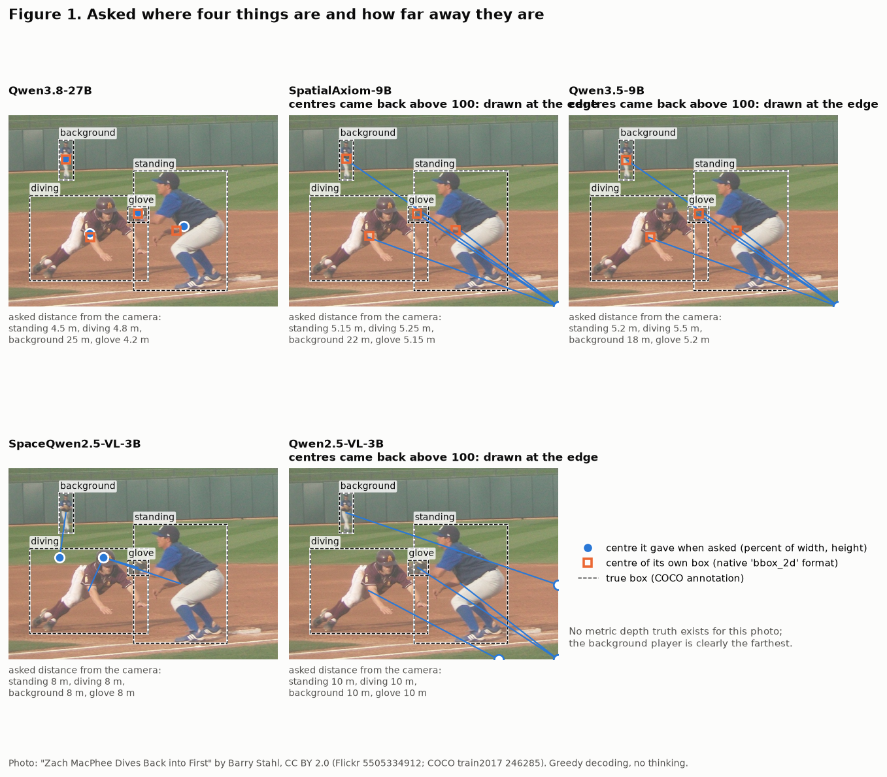

# Naming isn't locating: a probe inside the spatial information of vision-language models

When a vision-language model is asked how far away something is, is the answer a measurement? And where inside the
model does the measurement live? This repository asks five open models and then probes them layer by layer. The probes
read the vision tower, the image tokens in every language layer, and the state of the word that names the object.

**Pre-registered.** The pre-registration
([experiments/E01-spatial-ask-and-probe/PREREG.md](experiments/E01-spatial-ask-and-probe/PREREG.md)) was committed to git
(commit 4814ae9) before any GPU time was rented. The run cost $4.07 on one rented GPU ([docs/SPEND.md](docs/SPEND.md)).

## Headline results
abs-rel and % of the image diagonal: lower is better. Accuracy: higher is better. 95% intervals by bootstrap over
images.

| Qwen3.8-27B, test split | depth (abs-rel) | 2D position (% of diagonal) |
|---|---|---|
| name-only prior | 0.381 | 16.2 |
| **asked**, text answer | **0.377** | 167 (34% of answers on a 0-1000 scale; native boxes: **2.73**) |
| probe: vision tower | 0.161 | 3.91 |
| probe: image tokens, late language layers | 0.177 | 3.62 |
| probe: the object's word, with the image | **0.169** | 6.98 |
| probe: the same word, no image / mismatched image | 0.360 / 0.369 | 16.1 / 16.2 |
| specialist (MoGe-2 / RF-DETR) | 0.146 | 1.38 |

**What the measurements show:**
- **The measurement is in the language layers.** The object word keeps 0.96 [0.91, 1.02] of the vision tower's depth
  gain over the name prior. Late-layer image tokens keep 0.93 [0.88, 0.98].
- **It comes from the image.** With no image the word keeps 0.09; with a mismatched image, 0.05.
- **The pre-registered hypothesis is falsified for depth.** It held that measurement stays in the vision tower and the
  language side only names. It fails in all five models.
- **The text answer doesn't read the measurement out.** Asked depth is no better than the name prior: prior minus
  asked is 0.003 [-0.031, 0.039]. 2D position is read out, through the model's own box format.

**Spatial fine-tuning** (asked; paired on the same items):

| | depth (abs-rel) | yes/no relations (balanced acc.) | naming (acc.) |
|---|---|---|---|
| SpatialAxiom-9B (spatial SFT) vs its base Qwen3.5-9B | **0.233 vs 0.350** (-0.117 [-0.153, -0.080]) | **0.923 vs 0.838** | 0.884 vs 0.912 |
| SpaceQwen2.5-VL-3B (SpatialVLM-recipe reproduction) vs its base Qwen2.5-VL-3B | 0.567 vs 0.545 (n.s.) | 0.652 vs 0.783 | 0.819 vs 0.860 |

- **SpatialAxiom.** The spatial fine-tune makes spoken depth a real, if coarse, measurement (39% better than the
  prior). Its probes stay the same as its base's, so it changed the read-out, not the representation.
- **What SpatialAxiom gave up.** Some naming, and much of its 2D grounding (native boxes 11.7% vs 3.5% of the
  diagonal).
- **SpaceQwen.** The open SpatialVLM reproduction is better only on street distances. It loses on relations and
  naming.

Full results: [FINDINGS.md](FINDINGS.md), [E01 RESULTS](experiments/E01-spatial-ask-and-probe/RESULTS.md), every
number in [data/tables.md](experiments/E01-spatial-ask-and-probe/data/tables.md). Every result is also reported
without the two-person dataset's MMA and grappling frames, and no verdict changes.

## Experiments
- [E00](experiments/E00-token-layout-audit/): token-layout audit. Every image patch is mapped back to its image row
  and column on all five processors before any feature is read. The earlier probe's direct reshape misplaced 14,080 of
  14,400 locations.
- [E01](experiments/E01-spatial-ask-and-probe/): ask, then probe, layer by layer (pre-registered).

## Data and models
- **Public data only:** COCO, NYU Depth v2, Harmony4D multi-person capture, KITTI (held out).
- **Licences:** each one, and each model's, is in [docs/DATA.md](docs/DATA.md).
- **Images are not redistributed.** `src/build_dataset.py` rebuilds the set.
- **Features:** the extracted features, the models' answers and the labels are on a private Hugging Face dataset,
  available on request.

## Reproduce
Environments are in `env/`: `requirements-pod.txt` for the GPU run, `requirements-local.txt` for the analysis,
`requirements-moge.txt` for MoGe-2. The steps are listed in the
[E01 RESULTS](experiments/E01-spatial-ask-and-probe/RESULTS.md#reproduce). Smoke tests run on a CPU against
randomly initialised copies of each architecture: `tests/make_tiny.py`, `tests/check_extract.py`.

## Credits
- Qwen3.8 / Qwen3.5 / Qwen2.5-VL (Qwen team); SpatialAxiom-9B (Lou et al., 2026); SpaceQwen2.5-VL-3B (remyx.ai).
- MoGe-2 (Wang et al.); RF-DETR (Roboflow).
- COCO (Lin et al., 2014); NYU Depth v2 (Silberman et al., 2012); Harmony4D (Khirodkar et al., 2024); KITTI (Geiger et
  al., 2012).
- Figure 1 photo: "Zach MacPhee Dives Back into First" by Barry Stahl, CC BY 2.0.

Code: MIT (`LICENSE`). Text and figures: CC BY 4.0 (`LICENSE-docs`). Cite: `CITATION.cff`.
