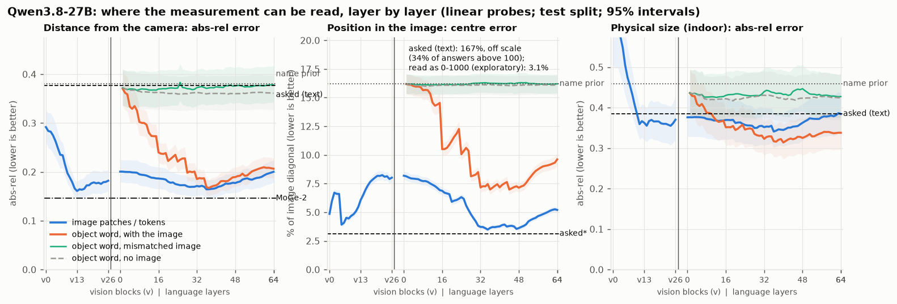
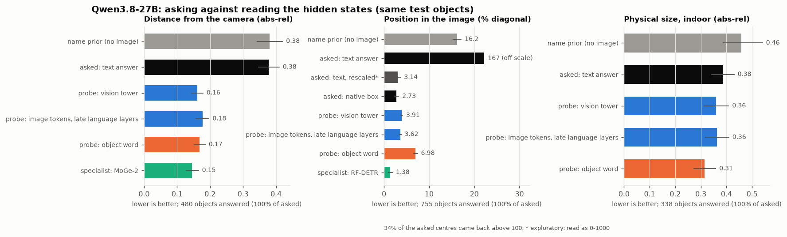
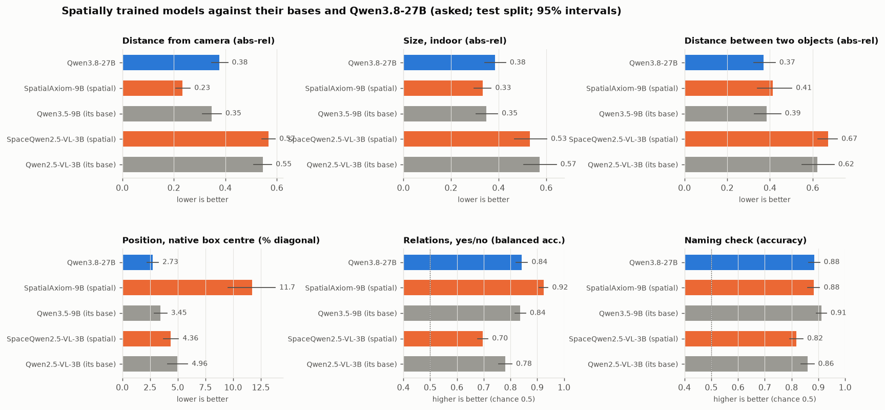
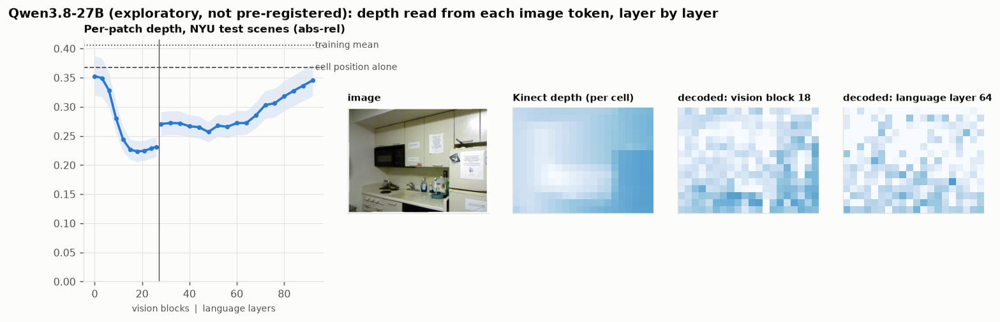

# E01 results: ask the model, then probe it, layer by layer

The pre-registration ([PREREG.md](PREREG.md)) was committed (local commit 4814ae9) before any GPU time was rented.

**Run.**
- One rented GPU (RTX PRO 6000 Blackwell, 96 GB) on 2026-10-28, 2.37 h.
- Total spend $4.07 of the $10 cap ([../../docs/SPEND.md](../../docs/SPEND.md)).
- All five models ran; nothing was cut.

Every number below is printed by `src/report_tables.py` from `data/results.json` into [data/tables.md](data/tables.md),
cited as `tables.md:line`. Intervals are 95% bootstrap intervals over images (2,000 resamples).

## Deviations from the plan
- **GPU.** An RTX PRO 6000 Blackwell ($1.69/h) instead of an A100: no A100 was available.
- **Patch embedding.**
  - The vision towers' patch embedding is a Conv3d whose kernel equals its stride. On this GPU it took about 45 s per
    batch.
  - It is computed as the same linear map, as a matrix product. On random copies of both architectures the two agree
    to a relative difference of 1e-6 (`tests/check_extract.py`).
  - The two partial extractions before this fix were discarded; no data from them is used.
- **Run order.** The order was changed mid-run (the SpaceQwen pair before SpatialAxiom) so that a budget cut would
  fall on SpatialAxiom. All five models finished.
- **Exploratory, decided after seeing the data,** and labelled as such wherever they appear:
  - 2D answers above 100 read on a 0-1000 scale;
  - a per-domain split of the depth answers;
  - the per-patch depth probe (Figure 5).
- **Not gated.** Rates with n < 30 are reported but enter no gate (e.g. two_people "above", n = 20).

## Data as built
| domain | images (train / test) | objects | truth |
|---|---|---|---|
| people (COCO val2017) | 269 / 115 | 910 | 2D boxes |
| indoor (NYU Depth v2, split by scene) | 276 / 124 | 1,086 | 2D, depth, 3D centre, size |
| two_people (Harmony4D, camera 1) | 129 / 71 | 400 | 2D, depth (pelvis), 3D centre |
| street (KITTI, held out) | 400 held out | 856 | 2D, depth, 3D centre, size |

two_people frames by sequence type: sword 67, karate 51, hugging 50, MMA 23, grappling 19, ballroom 6. Every number
is given for all frames (pre-registered) and without MMA and grappling ("calm"). The two give the same verdicts.

## Pre-registered outcomes (Qwen3.8-27B; test split of the training domains)
| # | question | result | verdict |
|---|---|---|---|
| G0 | controls behave (depth) | shuffled labels 0.480 and random features 0.478, both worse than the name prior 0.381 (abs-rel) | **pass** (`tables.md:24`) |
| G1 | the vision tower carries depth | tower 0.161 [0.144, 0.179] vs prior 0.381 [0.343, 0.420]: 58% better | **pass** (`tables.md:12,13,24`) |
| Q2 | does the language side keep it? | late-layer image tokens keep R = 0.93 [0.88, 0.98] of the tower's gain; the object word keeps R = 0.96 [0.91, 1.02] | **hypothesis falsified for depth** (`tables.md:14,16,24`) |
| Q2 | is the word's gain from the image? | word with no image R = 0.09 [0.05, 0.14]; with a mismatched image R = 0.05 [0.01, 0.09] | **yes** (`tables.md:17,18`) |
| Q1 | is the asked depth a measurement? | asked abs-rel 0.377 [0.346, 0.410] vs prior 0.381; prior minus asked 0.003 [-0.031, 0.039] | **qualitative** (`tables.md:169,180`) |
| Q3 | does spatial training help (SpatialAxiom-9B vs Qwen3.5-9B)? | asked depth 0.233 vs 0.350; difference -0.117 [-0.153, -0.080] | **yes, better** (`tables.md:1434`) |

**Secondary quantities** (same rule):

| quantity | R (late-layer image tokens) | R (word) | verdict |
|---|---|---|---|
| size | 0.97 | 1.46 | falsified (`tables.md:48,50,56`) |
| 2D position (only W is gated) | 1.02 | 0.75 [0.72, 0.78] | partial (`tables.md:32,34,40`) |

## Q1: what the model says, against what it holds (Qwen3.8-27B)

**Depth (abs-rel, lower is better).** Same 480 test objects in every column (`tables.md:169`):

| asked | name prior | probe: tower | probe: late image tokens | probe: word | MoGe-2 |
|---|---|---|---|---|---|
| 0.377 | 0.381 | 0.161 | 0.177 | 0.169 | 0.146 |

By domain:
- **Indoor:** asked 0.299, prior 0.372, MoGe-2 0.101 (`tables.md:171`).
- **Two people:** asked 0.565, worse than the prior's 0.402. The model overestimates by a median factor of 1.52
  (`tables.md:172,183`).
- **Held-out streets:** asked 0.199, MoGe-2 0.103 (`tables.md:170`). The street prior is not a fair baseline there: no
  street names are in training.

**2D position (% of the image diagonal, lower is better).**
- **Text answers.** 34% of the centres came back above 100, on the model's 0-1000 grounding scale, so the
  pre-registered percent-format score is 166.98 (`tables.md:173,184`).
  - Read on a 0-1000 scale (exploratory), they score 3.14.
- **Native boxes** (`bbox_2d`): 2.73, against the probes' 3.62 (late image tokens) and 6.98 (word), and RF-DETR's
  1.38 on its subset.

So 2D position is read out, through the grounding format the model was trained on.

**Other quantities** (`tables.md:176,178,82,78,241,250`):

| quantity | asked | name prior | probe: word | metric |
|---|---|---|---|---|
| size | 0.385 | 0.459 | 0.314 | abs-rel (lower is better) |
| distance between two objects | 0.370 | 0.636 (from the prior's centres) | 0.437 | abs-rel (lower is better) |

| check | score (higher is better) | comparison |
|---|---|---|
| relations, yes/no | 0.843 [0.821, 0.864] balanced accuracy | relations from the tower probe reach 0.955 |
| naming check | 0.885 [0.863, 0.905] | chance 0.5 |

Asked size beats the prior by only 16%, so it counts as qualitative under the rule.



**Where it lives** (Figure 2):
- **Depth, image tokens.** Depth peaks in the vision tower at block 13. It holds through the language model's image
  tokens; the best layer is 36 (0.164).
- **Depth, object word.** The word picks up depth from about layer 16 and matches the tower by layers 36-40. It then
  loses some towards the last layer.
- **2D position.** The image tokens carry position best in the later language layers (layer 47: 3.5% of the diagonal).
  The word state reaches only 7%.



## Q3: spatially trained models against their bases (asked; paired on the same items)



**SpatialAxiom-9B vs its base Qwen3.5-9B** (`tables.md:1430-1443`):

| measure | SpatialAxiom-9B | Qwen3.5-9B | difference (better is) |
|---|---|---|---|
| depth, test (abs-rel) | 0.233 | 0.350 | -0.117 [-0.153, -0.080] (lower) |
| depth, held-out streets (abs-rel) | 0.261 | 0.359 | -0.099 [-0.140, -0.057] (lower) |
| relations (balanced accuracy, all items) | 0.923 | 0.838 | +0.085 [0.069, 0.100] (higher) |
| naming (accuracy) | 0.884 | 0.912 | -0.028 [-0.045, -0.011] (higher) |
| size, test (abs-rel) | 0.333 | 0.349 | -0.016 [-0.058, 0.020] (lower) |
| 2D native boxes (% diagonal) | 11.72 [9.54, 13.81] | 3.45 [2.90, 4.03] | (lower) |

- Under the pre-registered rule, SpatialAxiom's asked depth is a measurement: it beats the prior by 39%
  (`tables.md:465`).
- Its asked depth still trails its own probes: tower 0.155, word 0.161 (`tables.md:454`).
- Its probes match its base's. Both keep about the same share of the tower's depth gain on the language side:
  - SpatialAxiom: R = 0.97 for both the late image tokens and the word (`tables.md:299,301`);
  - Qwen3.5-9B: R = 1.00 for the image tokens and 0.95 for the word (`tables.md:584,586`).

So the spatial fine-tune changed what the model says, not what it holds. It gained relations and lost a little naming,
and its native boxes got much worse.

**SpaceQwen2.5-VL-3B** (an open reproduction of the SpatialVLM data recipe) **vs its base Qwen2.5-VL-3B**
(`tables.md:1490-1501`):

| measure | SpaceQwen2.5-VL-3B | Qwen2.5-VL-3B | difference (better is) |
|---|---|---|---|
| depth, test (abs-rel) | 0.567 | 0.545 | +0.021 [-0.017, 0.061], no difference (lower) |
| depth, held-out streets (abs-rel) | 0.676 | 1.020 | -0.344 [-0.468, -0.229] (lower) |
| relations (balanced accuracy, all items) | 0.652 | 0.783 | -0.131 [-0.150, -0.114] (higher) |
| naming (accuracy) | 0.819 | 0.860 | -0.041 [-0.061, -0.021] (higher) |

- Both 3B models' test depth is worse than the name prior (0.380): SpaceQwen's median answer is 0.40 of the true
  distance (`tables.md:1024,1035`).
- Both keep the depth on the language side in their probes (R for the word: 0.83 and 0.85).

**Against Qwen3.8-27B** (`tables.md:1460-1473`, `tables.md:1516-1527`):
- SpatialAxiom-9B is better on test depth (-0.147 [-0.179, -0.114]) and relations (+0.088). It is worse on held-out
  street depth (+0.062) and equal on naming.
- SpaceQwen2.5-VL-3B is worse on depth, size, relations and naming. Its pre-registered 2D text score is better (49 vs
  167% of the diagonal) only because fewer of its answers left the percent scale.

## Without MMA and grappling frames
Every verdict above is unchanged (`tables.md:84-162` for the probes; the paired tables follow each "all frames"
table).

| Qwen3.8-27B, calm frames | value |
|---|---|
| depth: prior | 0.394 |
| depth: tower | 0.164 |
| depth: word | 0.172 |
| R (word) | 0.97 [0.92, 1.02] |
| R (late image tokens) | 0.92 [0.87, 0.97] |
| asked depth | 0.370, qualitative (`tables.md:196,207`) |

SpatialAxiom against its base on calm frames: depth -0.111 [-0.149, -0.071] (`tables.md:1449`).

## Exploratory: depth per image token (not pre-registered)



Every merged image token of the NYU test scenes, random-projected to 256 dimensions. Abs-rel, lower is better
(`data/dense_Qwen3.8-27B.json` on the dataset):

| readout | abs-rel |
|---|---|
| best vision block (18) | 0.223 [0.206, 0.241] |
| language layer 20 | 0.257 |
| last language layer | 0.345 [0.318, 0.374] |
| the cell's position alone | 0.368 |
| training mean | 0.406 |

Depth stays decodable from the object as a whole (pooled tokens, above) but fades from the individual tokens by the
last layer.

## Caveats
- Linear probes; one prompt wording; images at most 640 px; greedy decoding without thinking.
- two_people comes from one studio. Its test frames are later frames of the training sequences, which favours the
  probes there (tower 0.107 against MoGe-2's 0.253 on fisheye frames, `tables.md:172`).
- The probes are trained on these domains; the models' answers are zero-shot. The probes fail on held-out streets
  (tower 0.695, `tables.md:170`), so "the language side holds depth" is shown in-domain only.
- The name prior for streets uses no street names (none are in training), so it is not a fair street baseline.
- COCO has no metric truth, so the people domain scores 2D position only.

## Reproduce
```
python src/build_dataset.py {coco,kitti,kitti_classes,nyu,h4d,figure1,finish} ...   # data (see the docstring)
python src/pod/launch.py create|upload|start|watch ...                               # the rented-GPU run (src/pod/run_all.sh, run_rest.sh)
python src/probe.py --cache CACHE --model M ; python src/dense_probe.py --cache CACHE --model Qwen3.8-27B
python src/cv_reference.py moge|rfdetr ... ; python src/analyse.py --cache CACHE --out data/results.json
python src/report_tables.py --results data/results.json > data/tables.md ; python src/make_figures.py ...
```
