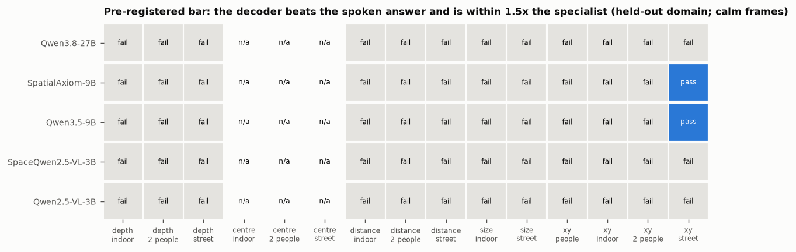

# E02 — Does a decoder on the hidden states transfer to a domain it never saw?

**Objective.** E01 found measurement in the language layers but not in the spoken answer. Here a decoder is trained on
some domains and tested on a whole domain it never saw. It is compared on the same objects with the model's own
answer, the name prior and a specialist (MoGe-2, RF-DETR).

**Setup.**
- Pre-registered ([PREREG.md](PREREG.md), pushed before any fit).
- Data: E01's cached features of all five models. Each domain in turn is held out of indoor, two people and street
  (plus people for 2D).
- Heads: ridge and one small MLP.
- Layer and head chosen on the training domains only.
- Controls as in E01.
- Pass bar: beat the spoken answer (CI above 0) and come within 1.5x the specialist.
- Cost: $0, run locally.

**Results** (Qwen3.8-27B, calm frames, depth abs-rel, lower is better):

| held out | decoder (object word) | spoken | MoGe-2 |
|---|---|---|---|
| indoor | 5.32 | 0.29 | 0.10 |
| two people | 0.73 | 0.57 | 0.23 |
| street | 0.82 | 0.20 | 0.10 |

- **Pass bar:** 2 of 50 folds across all models. Both passes are 2D position on streets, and both are weak (see
  RESULTS).
- **Orientation inside KITTI:** the object word reads which way a car faces to within about 10°.

**Verdict.** The decoder does not transfer. The language side's measurement is tied to the scene types the decoder
is trained on, while the spoken answer carries over much better.

**Next.** A decoder trained on many datasets (plan E03, not run).

Details: [RESULTS.md](RESULTS.md); every number: [data/tables_e02.md](data/tables_e02.md). Code:
`src/transfer.py`, `src/analyse_e02.py`, `src/make_figures_e02.py`.
