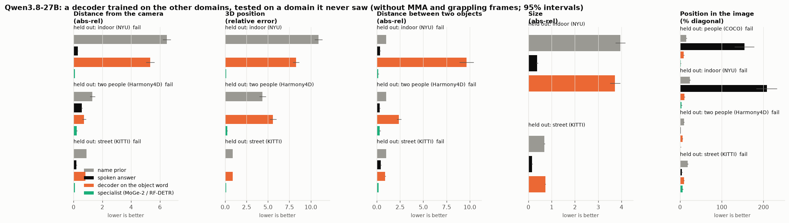

# E02 results: a decoder on the hidden states, tested on a domain it never saw

**Status.**
- Pre-registered ([PREREG.md](PREREG.md)): committed and pushed as ddeb5ce before any fit.
- Run locally on the E01 cache. No rented GPU; cost $0.
- Every number is printed by `src/analyse_e02.py` into [data/tables_e02.md](data/tables_e02.md), cited as
  `tables_e02.md:line`. The paper-facing tables come first, without the MMA and grappling frames ("calm"); the
  all-frames tables follow.
- Errors: lower is better. Intervals: 95% bootstrap over the held-out images.

## Verdict
**The decoder does not transfer.**
- Across all five models, it passes the pre-registered bar in **2 of 50** held-out folds that have both comparisons:
  depth 15, distance between two objects 15, 2D position 20 (Figure 7).
- Both passes are 2D position on held-out streets, for SpatialAxiom-9B and Qwen3.5-9B.
- **Both passes are weak.** They come from those models' spoken percent-format answers landing on a 0-1000 scale (as in
  E01), and from RF-DETR's high error on KITTI (5.90%). On the same streets, those models' own native boxes beat the
  decoder: 6.35 vs 9.37 and 4.47 vs 9.44 (`tables_e02.md:107,94,175,162`).
- **3D centre** had no spoken answer, so no pass bar.
- **Size** had no specialist. Its decoder lost to the spoken answer on every fold (`tables_e02.md:21-22`).


## Qwen3.8-27B (primary), calm frames
Distance from the camera, abs-rel (`tables_e02.md:12-14`):

| held out | decoder (object word) | spoken | MoGe-2 | name prior | vision tower | late image tokens |
|---|---|---|---|---|---|---|
| indoor (NYU) | 5.315 | 0.288 | 0.101 | 6.477 | 0.970 | 0.447 |
| two people (Harmony4D) | 0.730 | 0.574 | 0.233 | 1.306 | 0.830 | 1.167 |
| street (KITTI) | 0.817 | 0.199 | 0.103 | 0.898 | 0.697 | 0.760 |

- **Absolute scale.** Trained on the other two domains, the decoder carries their depth scale with it. Held out on
  indoor, it predicts street-and-studio distances and is barely better than the name prior.
- **Relative depth doesn't transfer either.** With each image's predictions rescaled to the right median
  (scale-invariant abs-rel), the decoder scores 0.287, 0.123 and 0.386 on the three held-out domains. The spoken answer
  scores 0.115, 0.051 and 0.150 (`tables_e02.md:33-35`).

**Position in the image** (% of the diagonal; `tables_e02.md:23-26,36-39`):

| held out | decoder (word) | native box | RF-DETR |
|---|---|---|---|
| people | 8.91 | 1.52 | 1.49 |
| indoor | 10.91 | 4.22 | 3.70 |
| two people | 5.95 | 1.26 | 1.30 |
| street | 9.39 | 4.10 | 5.90 |

**Distance between two objects** (abs-rel; `tables_e02.md:18-20`). The decoder scores 9.65, 2.39 and 0.92 against
the spoken answer's 0.35, 0.30 and 0.42.

**Orientation (KITTI only).** A within-street probe, not a transfer test (`tables_e02.md:27-31`):

| readout | error, across the five folds |
|---|---|
| object word | 9.4°-10.6° |
| vision tower | 13.9°-15.4° |
| name prior | 68°-80° |
| word with no image | 54°-64° |

The object word carries which way a car faces, better than the tower does, but only inside the domain it was trained
on.



## The other four models (calm; `tables_e02.md:76-108, 144-176, 212-244, 280-312`)
- **Same pattern.** Every depth, distance and size fold fails. On indoor depth the decoder scores 2.99-3.66 against
  spoken answers of 0.21-0.62.
- **Closest the decoder comes to transferring:** depth on the two-person domain for the 3B pair.

  | model | decoder | spoken | MoGe-2 | ratio to MoGe-2 |
  |---|---|---|---|---|
  | SpaceQwen2.5-VL-3B | 0.397 | 0.494 | 0.233 | 1.70 |
  | Qwen2.5-VL-3B | 0.385 | 0.388 | 0.233 | 1.65 |

  Neither passes: SpaceQwen misses on the specialist ratio (over 1.5), and Qwen2.5-VL-3B's decoder does not beat its
  spoken answer.
- **Orientation within KITTI:** 8°-17° for the word decoders in every model.

## What this means
- **Within-domain only.** The measurement E01 found in the language layers is learnable within the scene types a
  decoder is trained on (E01; the orientation folds here).
- **It doesn't carry to an unseen scene type.**
  - Absolute scale is tied to the training domains.
  - The decoder's relative depth is worse than the spoken answer's.
  - The spoken answer, which draws on the model's world knowledge, transfers much better than a decoder trained on two
    domains.
- **So a decoder from a few domains is not a route to measured answers.** Whether a decoder trained on many domains
  would be is the open question: it is E03 in [docs/PLAN_E03.md](../../docs/PLAN_E03.md), not run.

## Not measured, and why
- **Counts.** The saved features are per named object, and every named object is unique in its image.
- **Body and facing angles.** No angle labels were saved for the Harmony4D frames.
- Both are planned in E04 (`docs/PLAN_E03.md`).
- **Size has no specialist,** because MoGe-2 extents were not computed.

## Reproduce
```
python src/cv_reference.py rfdetr_e02 --data CACHE/data --out CACHE/cv_rfdetr_e02.json --weights rf-detr-medium.pth
python src/transfer.py --cache CACHE --model M          # each of the five models (local GPU, one at a time)
python src/analyse_e02.py --cache CACHE --out experiments/E02-decoder-transfer/data/results_e02.json
python src/make_figures_e02.py --results experiments/E02-decoder-transfer/data/results_e02.json --out docs/assets
```
The KITTI orientation labels for the E01 objects are read from the original `label_2` files: `alpha`, matched by
frame and class, since each class is unique in a frame. They are saved as `CACHE/e02_orientation.json`.
