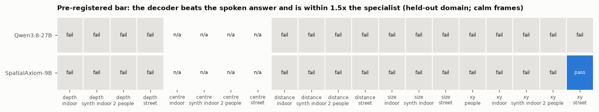

# E03 — Does a decoder trained on more scene types transfer?

**Objective.** E02's decoders trained on one or two scene types and failed on the held-out one. Here every decoder
trains on three, and indoor gets a sibling domain (synthetic indoor, Hypersim). Does the decoder now beat the model's
own spoken answer on a scene type it never saw?

**Setup.**
- Pre-registered ([PREREG.md](PREREG.md), pushed before any new data or fit).
- Domains: indoor (NYU), synthetic indoor (Hypersim, CC BY-SA 3.0), street (KITTI), two people (Harmony4D, calm
  sequences only); people (COCO) for 2D. Each held out in turn; train on the rest.
- Models: Qwen3.8-27B and SpatialAxiom-9B. Heads, layer choice, controls, specialists and pass bar as in E02.
- Cost: feature extraction shared the second rental with E06 (`docs/SPEND.md`); fitting ran locally for $0.

**Results** (Qwen3.8-27B, depth abs-rel, lower is better):

| held out | decoder (object word) | spoken | MoGe-2 |
|---|---|---|---|
| indoor | 0.45 | 0.29 | 0.10 |
| synthetic indoor | 0.28 | 0.23 | 0.18 |
| two people | 0.74 | 0.57 | 0.22 |
| street | 0.80 | 0.20 | 0.10 |

- **Pass bar:** 1 of 26 folds across both models, and that one is weak (2D on streets, as in E02).
- **Variety helps:** against E02 on the same held-out objects, the indoor depth error falls from 5.32 to 0.45; street
  barely moves (0.82 to 0.80). Better in 11 of 12 paired comparisons.

**Verdict.** More scene types help a lot where a similar scene type is in training, but the decoder still loses to the
model's own spoken answer on every unseen scene type, and stays well behind the specialists.

Details: [RESULTS.md](RESULTS.md); every number: [data/tables_e03.md](data/tables_e03.md); variety test:
[data/variety.json](data/variety.json). Code: `src/transfer.py --e03`, `src/analyse_e02.py --e03`,
`src/compare_e02_e03.py`, `src/make_figures_e02.py --tag _e03`.
