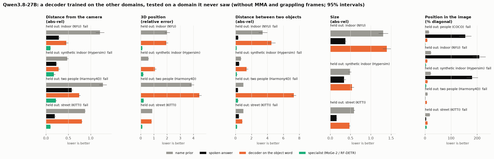
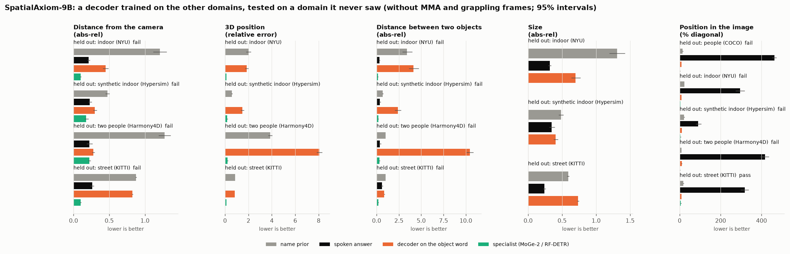

# E03 results: a decoder trained on more scene types, tested on one it never saw

**Status.**
- Pre-registered ([PREREG.md](PREREG.md)): committed and pushed as 0072699 before any new data was extracted or any
  fit was made.
- New features were extracted on the second rental (with E06; see `docs/SPEND.md`). The decoders were fitted locally on
  that cache; this part cost $0.
- Every number is printed by `src/analyse_e02.py --e03` into [data/tables_e03.md](data/tables_e03.md) and cited as
  `tables_e03.md:line`. E03 uses calm frames only, so its "without MMA and grappling" and "all frames" tables are
  identical. The paper-facing tables come first.
- Errors: lower is better. Intervals: 95% bootstrap over the held-out images.

**Data checks.**
- Hypersim's per-pixel 3D reproduces `depth_meters` to a median 0.0016% (worst frame 1.11%) over 997 frames in 50
  scenes. The pre-registered bar was 1% median, so Hypersim stays in.
- New images: 465 synthetic indoor (Hypersim), 407 two-person, 201 street, adding 2,418 named objects to E01's.

## Verdict
**The decoder still does not transfer.**
- It passes the pre-registered bar in **1 of 26** held-out folds that have both comparisons: depth 8, distance between
  two objects 8, 2D position 10 (Figure 7, E03 version).
- The one pass is SpatialAxiom-9B's 2D position on held-out streets. **It is weak, as in E02.**
  - The spoken percent-format answers came back on a 0-1000 scale (317% of the diagonal).
  - RF-DETR is poor on KITTI (5.84%).
  - The model's own native boxes score 6.35%, against the decoder's 9.12% (`tables_e03.md:101,110`).
- **On depth, the decoder loses to the model's spoken answer on every held-out domain, for both models.**
- **More variety helps, but not enough.** On the objects E02 also held out, training on one more domain cuts the indoor
  error by an order of magnitude and the street error slightly; the decoder is still worse than the spoken answer on
  both (section below).


## Qwen3.8-27B (primary)
Distance from the camera, abs-rel (`tables_e03.md:12-15`):

| held out | decoder (object word) | spoken | MoGe-2 | name prior |
|---|---|---|---|---|
| indoor (NYU) | 0.454 | 0.288 | 0.101 | 1.209 |
| synthetic indoor (Hypersim) | 0.284 | 0.231 | 0.178 | 0.476 |
| two people (Harmony4D) | 0.743 | 0.574 | 0.222 | 1.274 |
| street (KITTI) | 0.802 | 0.199 | 0.102 | 0.878 |

- Every fold beats the name prior but loses to the spoken answer.
- Closest call: synthetic indoor, 0.284 against 0.231 spoken.
- Street is no better than in E02 (0.802). With no street sibling in training, the decoder still cannot reach street
  distances.

**Relative depth** (scale-invariant abs-rel, images with at least two objects; `tables_e03.md:33-36`):

| held out | decoder (object word) | spoken | vision tower | MoGe-2 |
|---|---|---|---|---|
| indoor | 0.193 | 0.115 | 0.204 | 0.061 |
| synthetic indoor | 0.202 | 0.156 | 0.199 | 0.096 |
| two people | 0.935 | 0.051 | 0.083 | 0.079 |
| street | 0.456 | 0.150 | 0.249 | 0.072 |

Even with each image's scale corrected, the spoken answer orders objects better than the decoder on every held-out
domain.

**Distance between two objects** (`tables_e03.md:20-23`): the decoder scores 4.50, 1.40, 7.31 and 0.84, against 0.35,
0.44, 0.30 and 0.42 spoken. The two-person fold picked the first language layer on the training domains' inner folds
(the pre-registered rule); that choice transfers badly, here and for the 3D centre (4.45, `tables_e03.md:18`).

**Size** (no specialist, so only the spoken half of the bar applies): the decoder loses to the spoken answer on all
three folds, 1.40 / 0.54 / 0.48 against 0.37 / 0.34 / 0.16 (`tables_e03.md:24-26`).

**Position in the image** (% of the diagonal; `tables_e03.md:27-31`):
- The decoder lands 6.8-9.8% off on every held-out domain.
- RF-DETR beats it everywhere (1.2-5.8%), and so do Qwen3.8-27B's own native boxes (1.3-4.2%, `tables_e03.md:37-40`).
- The spoken percent answers are off scale on three domains (154-208%), as in E01.



## SpatialAxiom-9B
Depth, abs-rel (`tables_e03.md:82-85`): the decoder scores 0.450, 0.296, 0.278 and 0.824, against 0.212, 0.230, 0.221
and 0.261 spoken.
- Two people comes closest: the decoder at 0.278 is near both its spoken answer (0.221) and MoGe-2 (0.222), but the
  interval of spoken minus decoder does not clear 0.
- Everything else matches Qwen3.8-27B's pattern; the one pass is the weak 2D street fold above.



## Does variety help? (pre-registered)
On the held-out indoor and street objects that E02 also tested, E03's decoder (trained on one more domain) against
E02's; paired, the interval must exclude 0 ([data/variety.json](data/variety.json)):

| model | measure | indoor: E02 -> E03 | street: E02 -> E03 |
|---|---|---|---|
| Qwen3.8-27B | depth | 5.315 -> 0.454 (helps) | 0.817 -> 0.801 (helps) |
| Qwen3.8-27B | 3D centre | 8.289 -> 1.940 (helps) | 0.873 -> 0.815 (helps) |
| Qwen3.8-27B | size | 3.723 -> 1.397 (helps) | 0.725 -> 0.474 (helps) |
| SpatialAxiom-9B | depth | 2.988 -> 0.450 (helps) | 0.844 -> 0.822 (helps) |
| SpatialAxiom-9B | 3D centre | 5.512 -> 1.856 (helps) | 0.855 -> 0.832 (helps) |
| SpatialAxiom-9B | size | 3.964 -> 0.699 (helps) | 0.671 -> 0.730 (**worse**) |

Variety helps in 11 of 12 comparisons. The large gains are indoors, where E03 adds a sibling domain (Hypersim) next to
the held-out NYU. Street, which had no sibling in training, barely moves.

## What this means
- A decoder on the hidden states improves sharply when a similar scene type is in training, which is consistent with
  the read-out being tied to the scene types it has seen rather than to a general geometry.
- Within the tested range it never matches the model's own spoken answer on a scene type it did not train on, and it
  stays well behind the specialists.
- Whether many more scene types (and street siblings) would close the gap is not answered here: E03 has four domains
  and one street dataset.

## Known limits
- Two models; four domains; one street dataset (no licence-clear sibling was practical).
- Hypersim is synthetic, from few cameras per scene.
- Layer choice is by inner leave-one-domain-out on three training domains, as pre-registered; on the two-person fold it
  picked the first language layer, which transferred badly.

## Reproduce
```
python src/build_dataset.py ...                     # E03 parts; see docs/DATA.md
python src/pod/launch.py ...                        # extraction on the rented GPU (E03 + E06), see docs/SPEND.md
python src/transfer.py --cache CACHE --model M --device cuda --e03 CACHE_E03     # Qwen3.8-27B, SpatialAxiom-9B
python src/analyse_e02.py --cache CACHE --e03 CACHE_E03 --models Qwen3.8-27B,SpatialAxiom-9B \
    --out experiments/E03-many-domain-decoder/data/results_e03.json
python src/compare_e02_e03.py --cache CACHE --e03 CACHE_E03 --out experiments/E03-many-domain-decoder/data/variety.json
python src/make_figures_e02.py --results experiments/E03-many-domain-decoder/data/results_e03.json --out docs/assets --tag _e03
```
