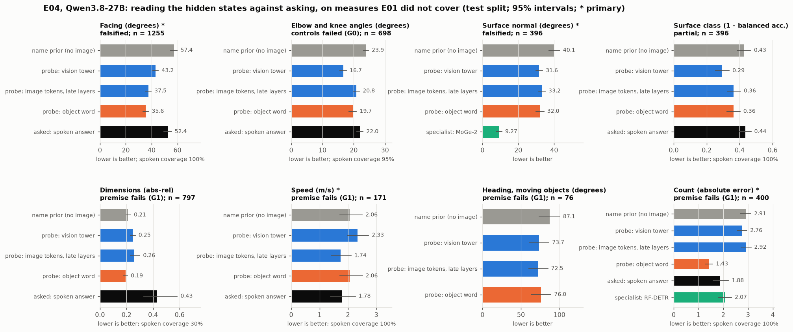

# E04 — The measures E01 did not cover

**Objective.** E01 found that the object word holds metric depth, but the spoken answer does not use it. E04 asks the
same question about the other quantities a camera-based system measures:
- **orientation:** which way an object or a person faces, and elbow and knee angles;
- **surfaces and shape:** which way an object's main surface faces, its class (up, towards the camera, sideways), and
  its dimensions;
- **motion over four frames:** speed and heading;
- **counts:** how many objects of a class.

**Setup.**
- Pre-registered ([PREREG.md](PREREG.md), pushed as 40feb44 before any data was built or GPU rented).
- 4,379 images or clips and 4,979 objects from KITTI object and tracking, Harmony4D (calm sequences only), Objectron,
  Hypersim, NYU Depth v2 and COCO.
- All five E01 models, every layer. E01's probes, prior, controls and gates, unchanged.
- Specialists: MoGe-2's surface normals (median inside the object's mask) and RF-DETR's counts.
- Cost: $5.39 on one rented GPU, under the $9.34 cap ([docs/SPEND.md](../../docs/SPEND.md)).
- Deviations (fewer NYU and Objectron items than planned, two bugs fixed before any model saw the data or before
  scoring, three models' features not yet on Hugging Face): listed in [RESULTS.md](RESULTS.md).

**Primary results** (Qwen3.8-27B, test split, lower is better; `data/tables_e04.md:9,11,14,16`):

| measure | name prior | vision tower | object word | spoken | specialist | pre-registered outcome |
|---|---|---|---|---|---|---|
| facing (degrees) | 57.4 | 43.2 | **35.6** | 52.4 | none | **falsified**: the word carries it better than the tower |
| surface normal (degrees) | 40.1 | 31.6 | 32.0 | not asked | **9.3** (MoGe-2) | **falsified**, by a hair: the word is 20.1% better than the prior, against a 20% bar |
| speed (m/s) | 2.06 | 2.33 | 2.06 | 1.78 | none | premise fails: the tower reads only the last frame |
| count (absolute error) | 2.91 | 2.76 | **1.43** | 1.88 | 2.07 (RF-DETR) | premise fails: the tower is averaged over the whole image |

**Verdict.**
- **Where the vision tower carries a measure, the object word carries it too.** For facing and the surface normal the
  pre-registered hypothesis (measurement stays in the tower; the language side only names) is falsified, as it was for
  depth in E01. The word's gain comes from the image: with no image or a mismatched one, the word is no better than
  the name.
- **The spoken answer does not read it out.** Facing is 52.4° spoken against 35.6° from the word. The spoken surface
  class is no better than the prior.
- **Counting is the exception.** The spoken count is a real measurement (35% better than the prior), level with
  RF-DETR. The class word's state counts better than both (1.43 against 1.88 spoken and 2.07 for RF-DETR).
- **Across the five models:** facing is falsified in all five, the surface normal in the two larger Qwen3-family
  models. Spoken counts are measurements in four of five; spoken facing is worse than the name prior in four of five.
- **Speed, heading and dimensions are not in the tower** at the pre-registered bar. For speed this is by construction:
  the tower's read-out sees one frame.

Details, other models and every deviation: [RESULTS.md](RESULTS.md); every number: [data/tables_e04.md](data/tables_e04.md).
Code: `src/build_e04.py`, `src/e04_parts/`, `src/extract_e04.py`, `src/probe_e04.py`, `src/cv_e04.py`,
`src/analyse_e04.py`, `src/make_figures_e04.py`.
