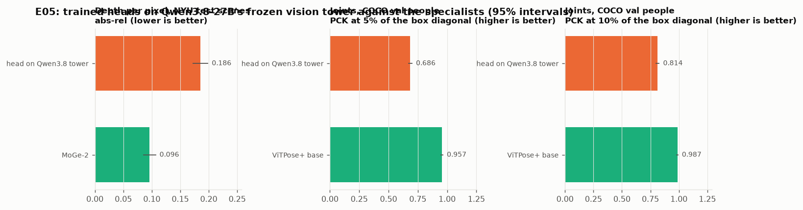

# E05 results: heads on Qwen3.8-27B's own vision tower against the specialists

**Status.**
- Pre-registered ([PREREG.md](PREREG.md), pushed as 0072699 before any head was trained).
- Run on the local 6 GB GPU. Cost $0.
- The frozen tower was loaded on its own from shard 1 of 18 of `Qwen/Qwen3.8-27B` @ 1d4bf0f2: every `model.visual.*`
  weight loaded, none missing.
- Numbers: [data/results_e05.json](data/results_e05.json). 95% intervals by bootstrap over images (depth) or people
  (joints).

**Deviations, all decided before training:**
- **Input size.** Depth images are fed at 1024x768, not the pre-registered 960x720, because the processor needs
  multiples of 32 (patch 16 x merge 2). That gives 48x64 patches and a 96x128 depth grid.
- **Training images.** The depth head trains on E01's 276 NYU images in the training scenes, not every labelled image
  in those scenes. The NYU file could not be moved to the rented GPU for E03 (the NYU server served 0.4 MB/s there),
  so only the 400 images already extracted were available.
- **Feature caching.** The frozen tower's features for the training images were computed once and cached (fp16), not
  recomputed each epoch. Same numbers, about 30x faster.

## Results
| measure | head on the Qwen3.8 tower | specialist | bar | verdict |
|---|---|---|---|---|
| depth per pixel, NYU test scenes (124 images, 38.1M pixels), abs-rel (lower is better) | **0.186** [0.173, 0.198] | MoGe-2 **0.096** [0.085, 0.107] | within 1.5x | **fail** (1.94x) |
| depth, δ < 1.25 (higher is better) | 0.706 [0.681, 0.734] | 0.904 [0.879, 0.924] | (reported) | |
| joints, COCO val (600 people, 7,429 visible keypoints), PCK@5% of the box diagonal (higher is better) | **0.686** [0.670, 0.701] | ViTPose+ base **0.957** [0.949, 0.964] | no more than 10 points below | **fail** (27.2 points below) |
| joints, PCK@10% | 0.814 [0.800, 0.827] | 0.987 [0.982, 0.992] | (reported) | |



## What this means
- **The information is there, at coarse precision.** A trained head reads per-pixel depth from Qwen3.8's tower at
  0.186 abs-rel, twice MoGe-2's error. For a loose comparison, since the grain differs: E01's exploratory linear probe
  per 32-px token reached 0.223 at best in the tower and 0.345 at the last language layer.
- **Joints are recoverable to about 7 in 10 within 5% of the body box,** against ViTPose's 96%.
- **Both fall short of the specialists by a wide margin,** and both heads were trained and tested in-domain.
- So the vision tower holds geometry a head can read, but not at the precision engagement measures need: joints to a
  few pixels, depth to a few percent. The specialists remain the right measurement layer, and the VLM the right
  reasoning layer.

## Reproduce
```
python src/dense_head.py data_joints --coco annotations_trainval2017.zip --out CROPS
python src/dense_head.py depth  --shard model-00001-of-00018.safetensors --cfg QWEN38_CONFIG_DIR --nyu NYU_DIR --out OUT
python src/dense_head.py moge   --nyu NYU_DIR --out OUT                          (MoGe-2 environment)
python src/dense_head.py joints --shard ... --cfg ... --crops CROPS --out OUT
python src/dense_head.py vitpose --crops CROPS --out OUT                        (ViTPose+ environment)
python src/dense_head.py score  --crops CROPS --out OUT
```
`NYU_DIR` holds E01's `dataset.json` (also as `e01_dataset.json`), `nyu_dense.npz` and images.
`data/people_used.json` lists the COCO people (annotation ids). Images are not redistributed.
