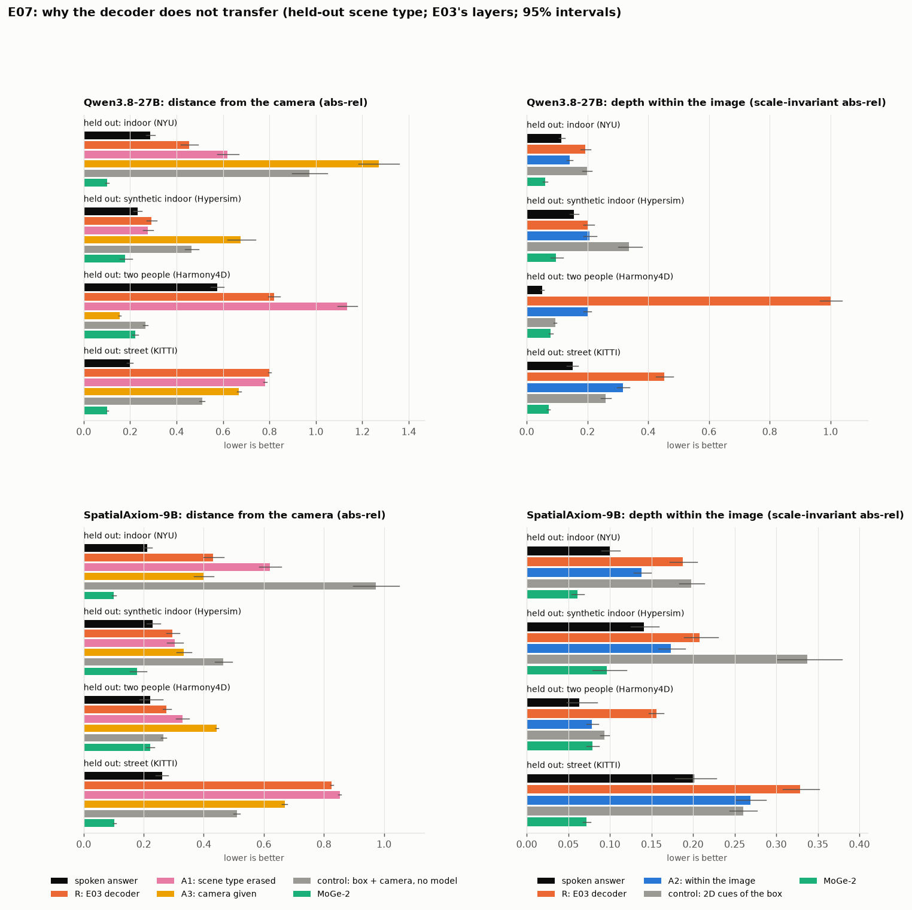

# E07 results: why the decoder does not transfer

**Status.**
- Pre-registered ([PREREG.md](PREREG.md)): committed and pushed as 9da8ec5 before any fit.
- Run locally on CPU on the E03 cache; $0. Every number is printed by `src/analyse_e07.py` into
  [data/tables_e07.md](data/tables_e07.md) and cited as `tables_e07.md:line`.
- Depth only. Errors: lower is better. Intervals: 95% bootstrap over the held-out images (2,000 resamples), paired.
- **Disclosure.** Before the full run, a one-fold smoke run (Qwen3.8-27B, indoor held out; same fitting code) was
  scored to test the code, and its numbers were seen. The scoring script was written after it. It implements the
  pre-registered comparisons unchanged, and the smoke fold's numbers equal the full run's.

## Checks
- **Reference.** R, E03's decoder refitted by this code, reproduces E03's published held-out error within 5% on 7 of 8
  folds (`tables_e07.md:111-118`). The miss is Qwen3.8-27B with two people held out: 0.819 against 0.743
  (`tables_e07.md:113`). That fold's head is the MLP on the first language layer, and it refits differently on CPU than
  on the GPU E03 used. As pre-registered, the gap is reported and the comparisons still use R.
- **Erasure works.** Before erasure, a linear classifier names the training scene type in 84-100% of cases. After it,
  it does exactly as well as always guessing the largest scene type (35-37%) (`tables_e07.md:111-118`).

## Verdict
| hypothesis | arm | helps (of 8 folds) | hurts | pre-registered reading | passes E03's bar where R fails |
|---|---|---|---|---|---|
| H1: the decoder learns scene type, not geometry | A1, erase scene type | 2 | 5 | **mixed** (mostly hurts) | none |
| H2: absolute scale fails; geometry inside an image transfers | A2, within the image | 7 | 0 | **supported** | none |
| H3: without the camera, metric depth is ambiguous | A3, give the camera | 4 | 4 | **mixed** | Qwen3.8-27B, two people |

(`tables_e07.md:52-54`.) In one sentence: **the decoder's failure on new scene types is mostly a failure of absolute
scale.** The order and ratios of depths inside an image do transfer. Removing scene-type information does not help,
and giving the camera helps only where the object's physical size is predictable.



## A1: erase scene type (H1 not supported)
- Qwen3.8-27B: indoor 0.454 -> 0.620, two people 0.819 -> 1.134 (worse); synthetic indoor 0.291 -> 0.276 and street
  0.802 -> 0.782 (slightly better) (`tables_e07.md:9-10, 14-15, 19-20, 24-25`).
- SpatialAxiom-9B: worse on indoor (0.431 -> 0.620), two people (0.276 -> 0.328) and street (0.826 -> 0.853); no
  difference on synthetic indoor (`tables_e07.md:29-30, 34-35, 39-40, 44-45`).
- Reading: the directions that tell the scene types apart also carry depth level. Removing them takes away information
  the decoder needs, rather than a shortcut it misuses.

## A2: depth within the image (H2 supported)
Scale-invariant abs-rel; E03's decoder (R) scored the same way:

| model | held out | R | A2 | 2D cues of the box (control) | spoken | MoGe-2 |
|---|---|---|---|---|---|---|
| Qwen3.8-27B | indoor | 0.193 | **0.142** | 0.198 | 0.115 | 0.061 |
| Qwen3.8-27B | synthetic indoor | 0.203 | 0.207 | 0.337 | 0.156 | 0.096 |
| Qwen3.8-27B | two people | 1.003 | **0.200** | 0.094 | 0.051 | 0.079 |
| Qwen3.8-27B | street | 0.452 | **0.318** | 0.260 | 0.151 | 0.072 |
| SpatialAxiom-9B | indoor | 0.188 | **0.138** | 0.198 | 0.101 | 0.061 |
| SpatialAxiom-9B | synthetic indoor | 0.208 | **0.173** | 0.337 | 0.141 | 0.096 |
| SpatialAxiom-9B | two people | 0.156 | **0.079** | 0.094 | 0.063 | 0.079 |
| SpatialAxiom-9B | street | 0.329 | **0.269** | 0.260 | 0.201 | 0.072 |

(`tables_e07.md:11, 13, 16, 18, 21, 23, 26, 28, 31, 33, 36, 38, 41, 43, 46, 48`; bold = better than R, interval above 0.)
- Better than R in 7 of 8 folds, worse in none.
- Beats the box's own 2D cues (box size, position and shape, also centred per image) in 5 folds: indoor and synthetic
  indoor for both models, and SpatialAxiom-9B's two people. It ties them on SpatialAxiom-9B's street and loses to them
  on Qwen3.8-27B's street and two people. Where it loses, the box alone orders the objects better.
- **It never beats the spoken answer.** The model's own words order the objects in an image better than any read-out
  trained here, on every fold (the "spoken minus arm" interval is below 0 on all 8).
- Exploratory, with the layer re-chosen: on Qwen3.8-27B's two people, A2 reaches 0.059, level with the spoken 0.051
  (the interval of the difference spans 0) and better than MoGe-2's 0.079 (`tables_e07.md:72`).

## A3: give the camera (H3 mixed)
The decoder predicts each object's physical size; depth = size / angular size (box and focal length).
- **One pass:** Qwen3.8-27B, two people held out.
  - A3 reaches 0.155, against 0.574 spoken and 0.222 for MoGe-2 (0.70x), and against 0.266 for box + camera with no
    model (`tables_e07.md:22`).
  - People have a predictable size, and the street training set includes pedestrians and cyclists.
  - The model's state adds to the geometry alone (control minus arm 0.111, interval 0.096-0.126).
- **The control matters.** On two people, box + camera alone (0.266) already beats the spoken answer (0.574)
  (`tables_e07.md:22`). There, the decisive input is the box and the camera, not only the model.
- **Elsewhere it hurts or helps a little:**
  - indoor 1.270 (Qwen3.8-27B) and 0.399 (SpatialAxiom-9B), against the control's 0.973;
  - street 0.669 for both models, against 0.510 for the control (`tables_e07.md:12, 27, 32, 47`).
  - The physical sizes of an unseen scene type's objects (rooms full of furniture against streets of cars) are as
    domain-bound as their depths.
- SpatialAxiom-9B on two people is worse than R (0.444 against 0.276; `tables_e07.md:42`).

## What this means
- **"Doesn't transfer" is mostly a statement about absolute scale.** Within an image, the hidden state orders objects
  by depth in a way that carries over to scene types the decoder never saw. The metric scale does not carry over.
- **The model's spoken answer already does this better.** On relative depth it beats every read-out here, while Qwen3.8-27B's
  absolute spoken depth is no better than a name-only guess (E01). It has the geometry, and its words carry the ordering; what
  neither the words nor a simple read-out recovers on a new scene type is metres.
- **Metres need what a specialist has:** the camera, and objects of known size. Given both, the decoder passes once,
  and box plus camera alone go most of the way. That is the specialists' route (MoGe-2 estimates the camera), not a
  property of the language model's state.

## Known limits
- Two models, four scene types, depth only.
- The read-out with attention over every image token (the "narrow read-out" hypothesis) is not tested; it needs a new
  extraction (see the pre-registration).
- The angular size uses the true box. The spoken answer had no box, so A3 against the spoken answer is not like for
  like; the box + camera control is the fair comparison.
- KITTI and NYU are treated as pinhole cameras; Harmony4D's fisheye is undistorted with its calibration.
- R does not reproduce E03 on one fold (above).

## Reproduce
```
ENGAGE3D_SRC=.../engage3d/src python src/cameras_e07.py --cache CACHE --e03 CACHE_E03 \
    --hypersim-meta HYPERSIM_META/metadata_camera_parameters.csv --out CACHE_E03/e07_cameras.json
python src/diagnose_e07.py --cache CACHE --e03 CACHE_E03 --model Qwen3.8-27B       # and SpatialAxiom-9B (CPU, ~1 h each)
python src/analyse_e07.py --cache CACHE --e03 CACHE_E03 --out experiments/E07-transfer-diagnosis/data/results_e07.json
python src/make_figures_e07.py --results experiments/E07-transfer-diagnosis/data/results_e07.json --out docs/assets
```
